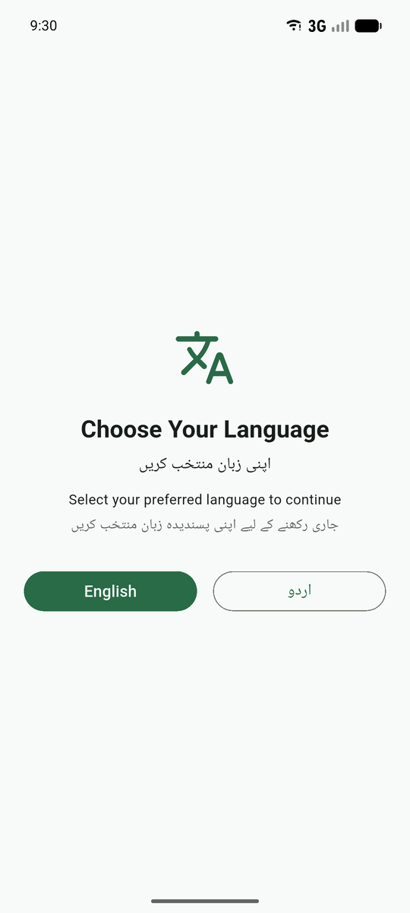
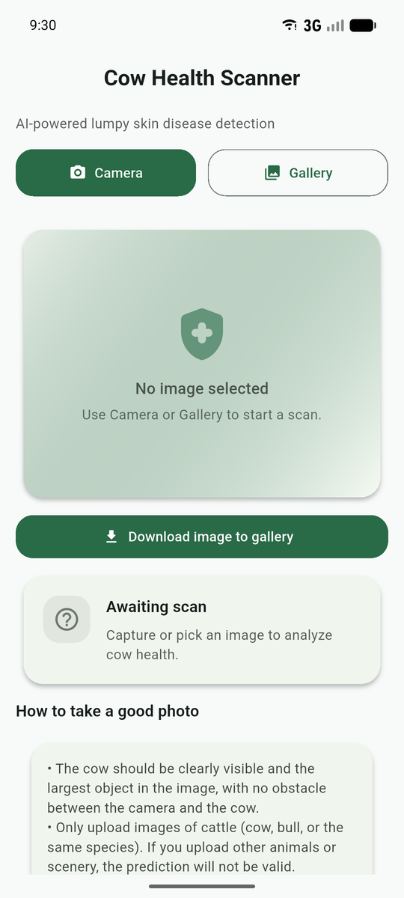
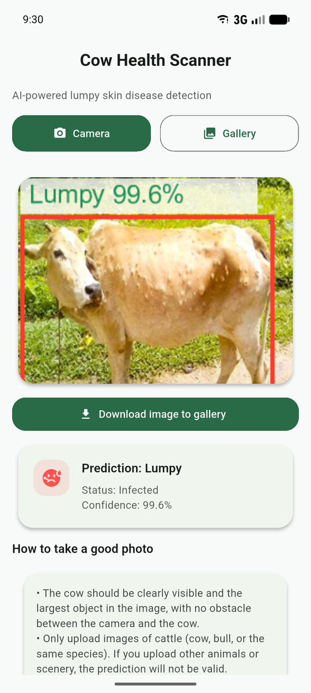
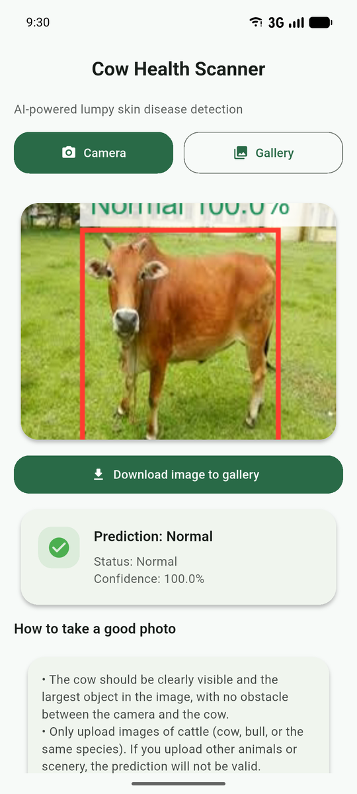
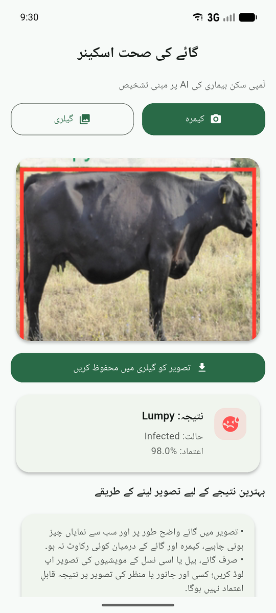
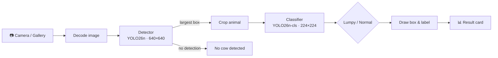

<div align="center">

# 🐄 Cow Health Scanner

**On-device AI for early detection of Lumpy Skin Disease in cattle**

[](https://flutter.dev)
[](https://dart.dev)
[](#getting-started)
[](https://www.tensorflow.org/lite)
[](https://docs.ultralytics.com)

Snap or upload a photo of a cow. The app finds the animal, analyses its skin,
and tells you within seconds whether it shows signs of **Lumpy Skin Disease (LSD)**.
All inference runs **offline on the phone**, so it works in the field with no internet connection.

</div>

---

## 📱 Screenshots

<table>
  <tr>
    <td align="center"></td>
    <td align="center"></td>
    <td align="center"></td>
    <td align="center"></td>
    <td align="center"></td>
  </tr>
  <tr>
    <td align="center"><sub><b>Language selection</b></sub></td>
    <td align="center"><sub><b>Home</b></sub></td>
    <td align="center"><sub><b>Lumpy skin detected</b></sub></td>
    <td align="center"><sub><b>Healthy cow</b></sub></td>
    <td align="center"><sub><b>Urdu (RTL) interface</b></sub></td>
  </tr>
</table>

---

## ✨ Features

- **Two-stage AI pipeline**: a YOLO detector locates the cow, then a YOLO classifier diagnoses the cropped region
- **Fully offline**: TensorFlow Lite models are bundled in the app; no images ever leave the device
- **Camera or gallery input**: take a photo in the field or analyse an existing one
- **Visual results**: bounding box and label drawn on the image, plus a status card with the confidence score
- **Save annotated results** to the device gallery with one tap
- **Bilingual**: full English and Urdu support with right-to-left layout
- **Responsive UI**: heavy image work runs in background isolates to keep the interface smooth
- **Built-in guidance** on how to take a photo that gives reliable results

---

## 🧠 How It Works



| Stage | Model | Input | Output |
|---|---|---|---|
| **Detection** | `models/detector/yolo26n_float32.tflite`: COCO-pretrained YOLO26n (end-to-end export) | 640 × 640 RGB | Up to 300 boxes `[x1, y1, x2, y2, score, class]` |
| **Classification** | `models/best_float32.tflite`: YOLO26n-cls fine-tuned on an LSD dataset | 224 × 224 RGB | Probabilities for `lumpy` / `normal` |

The detector keeps detections with confidence ≥ 0.25 and selects the **largest** box. Classes are deliberately not filtered,
because the COCO model often labels local cattle breeds as *horse*, *elephant*, and so on. The crop is then classified and the result
is drawn back onto the original photo.

> Float16 variants of both models are also bundled for size- or speed-sensitive deployments.

---

## 🛠 Tech Stack

| Area | Technology |
|---|---|
| Framework | Flutter (Material 3) |
| Language | Dart |
| On-device ML | [`tflite_flutter`](https://pub.dev/packages/tflite_flutter) |
| Image processing | [`image`](https://pub.dev/packages/image) |
| Image input | [`image_picker`](https://pub.dev/packages/image_picker) |
| Gallery export | [`flutter_image_gallery_saver`](https://pub.dev/packages/flutter_image_gallery_saver) |
| Localisation | `flutter_localizations` (English, Urdu) |
| Model training | [Ultralytics YOLO](https://docs.ultralytics.com) |

---

## 🚀 Getting Started

### Prerequisites

- [Flutter SDK](https://docs.flutter.dev/get-started/install) **3.38+** (Dart 3.10+)
- Android Studio with the Android SDK, and either a physical Android device or an emulator (x86_64 or arm64)

### Installation

```bash
# Clone the repository
git clone https://github.com/khizerhaider/lumpy-skin-detection.git
cd lumpy-skin-detection/LSD/CodeBase

# Install dependencies
flutter pub get

# Run on a connected device or emulator
flutter run
```

### Build a release APK

```bash
flutter build apk --release
# Output: build/app/outputs/flutter-apk/app-release.apk
```

---

## 📂 Project Structure

```
lib/
├── main.dart                        # App entry, theme, language routing
├── l10n/app_strings.dart            # English & Urdu strings
├── ml/
│   ├── detector_service.dart        # YOLO detection: locate the cow
│   ├── classifier_service.dart      # YOLO-cls: lumpy vs normal
│   └── pipeline_service.dart        # detect → crop → classify → annotate
├── screens/
│   ├── language_selection_screen.dart
│   └── home_screen.dart
└── widgets/
    ├── image_preview.dart
    └── result_card.dart
models/
├── best_float32.tflite / best_float16.tflite              # Disease classifier
└── detector/yolo26n_float32.tflite / yolo26n_float16.tflite  # Cow detector
test/
└── widget_test.dart                 # Language flow & home screen tests
```

---

## 🧪 Testing

```bash
flutter analyze   # static analysis
flutter test      # widget tests (language selection, English & Urdu home screens)
```

---

## 📸 Tips for Best Results

- Photograph **one animal at a time**, so the cow is the largest object in the frame
- Capture the **full body or a large skin area** in good natural light
- Avoid obstacles between the camera and the animal
- Use photos of cattle only; other species give unreliable predictions

---

## ⚠️ Limitations

- Only the **largest** detected object is analysed in each photo
- Non-cattle images (e.g. other animals) may still be classified, so follow the photo guidelines
- Accuracy may drop for breeds, lighting conditions or camera angles that are under-represented in the training data
- Currently configured and tested for **Android**

For an in-depth explanation of the architecture, pipeline and design decisions, see **[DOCUMENTATION.md](DOCUMENTATION.md)**.

---

## 🩺 Disclaimer

This application is a **screening aid** intended to support farmers and field workers.
It is **not** a substitute for professional veterinary diagnosis. Always consult a qualified
veterinarian to confirm a diagnosis and plan treatment.

---

## 🙏 Acknowledgements

- [Ultralytics](https://ultralytics.com) for the YOLO framework used to train and export the models. The models are subject to the [AGPL-3.0 license](https://ultralytics.com/license).
- The [Flutter](https://flutter.dev) and [TensorFlow Lite](https://www.tensorflow.org/lite) teams
