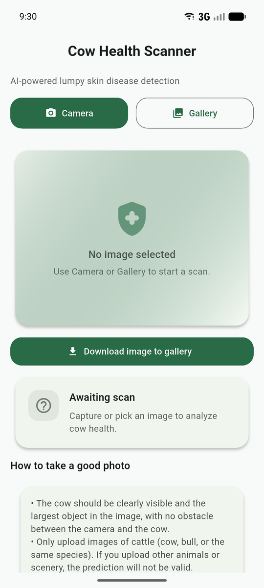
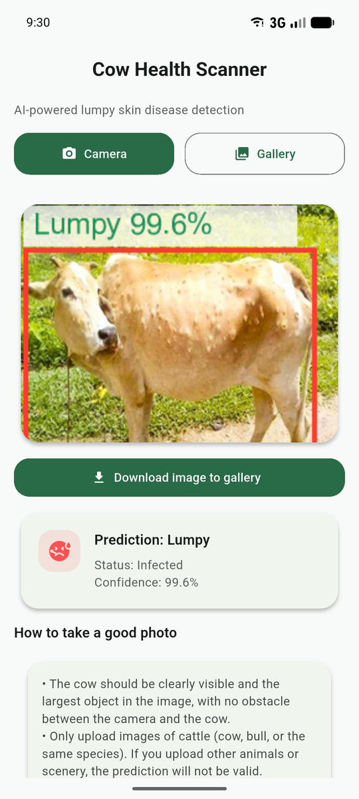
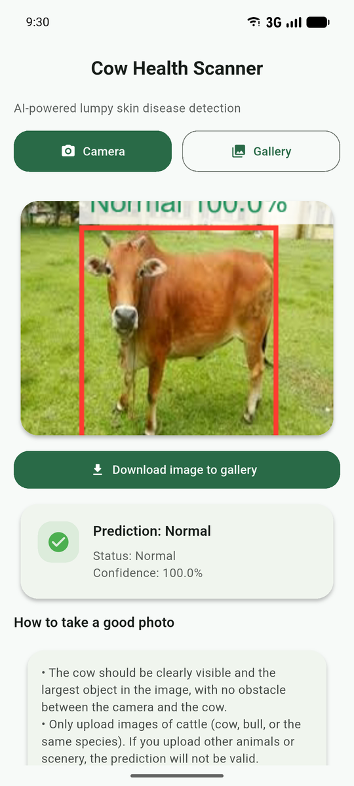

<div align="center">

# 🐄 Smart Cattle Health System

**AI-powered tools for livestock health monitoring**

[](https://flutter.dev)
[](https://www.tensorflow.org/lite)
[](https://docs.ultralytics.com)

</div>

---

## 📖 Overview

This repository contains the components of a cattle health system made up of two modules:

| Module | Description | Status |
|---|---|---|
| **[LSD: Lumpy Skin Detection](LSD/CodeBase/README.md)** | Offline mobile app that detects a cow in a photo and classifies it as *Lumpy* or *Normal* | ✅ Available |
| **Weight Estimation** | Estimation of cattle body weight | 🚧 In progress |

<p align="center">
  
  &nbsp;
  
  &nbsp;
  
</p>

---

## 📂 Repository Structure

```
.
├── LSD/                     # Lumpy Skin Detection
│   ├── Dataset/             # Dataset (to be added)
│   └── CodeBase/            # Flutter mobile app + TFLite models
└── Weight Estimation/       # Cattle weight estimation module (to be added)
```

---

## 🚀 Quick Start: Lumpy Skin Detection

```bash
git clone https://github.com/khizerhaider/lumpy-skin-detection.git
cd lumpy-skin-detection/LSD/CodeBase
flutter pub get
flutter run
```

See the **[LSD CodeBase README](LSD/CodeBase/README.md)** for features, architecture and setup details,
and **[DOCUMENTATION.md](LSD/CodeBase/DOCUMENTATION.md)** for the full technical documentation.

---

## 🩺 Disclaimer

These tools are screening aids and are **not** a substitute for professional veterinary diagnosis.
